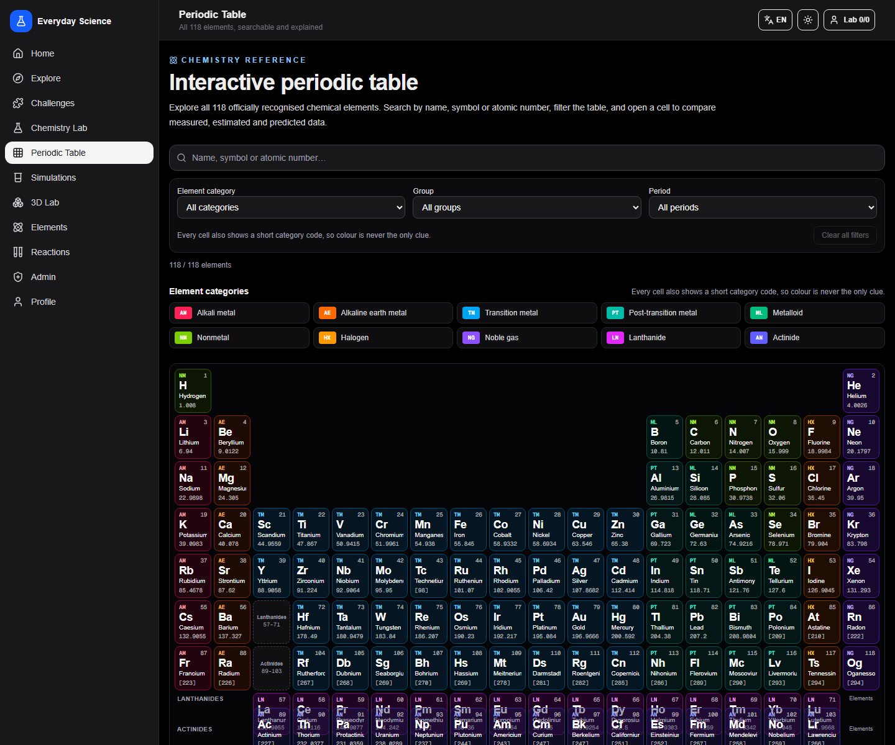
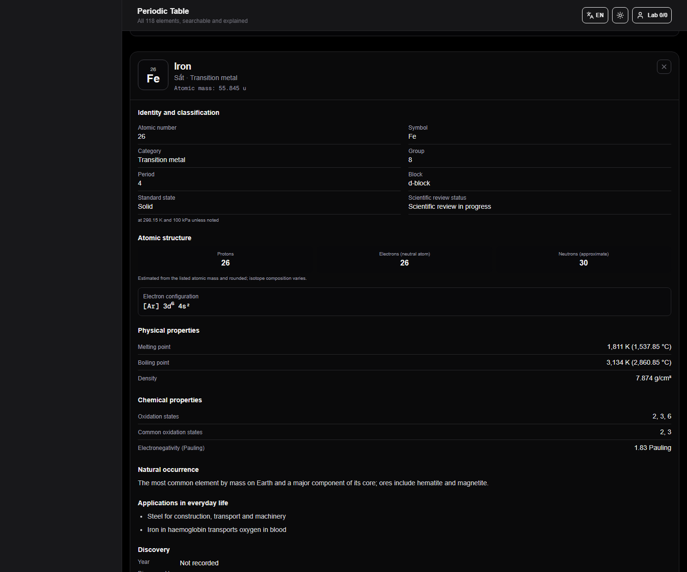
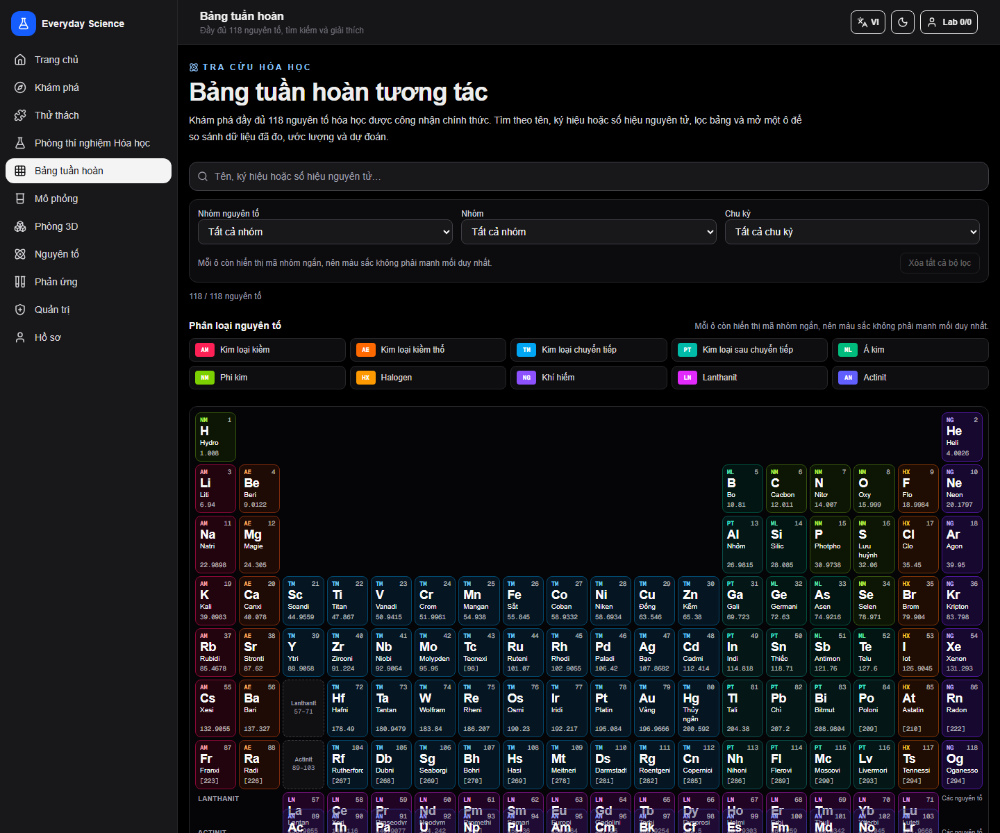
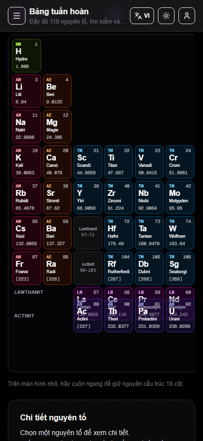

# Interactive Periodic Table

Route: `/chemistry/periodic-table`

The periodic table is a chemistry reference experience for all 118 officially
recognised elements. It is separate from the `/elements` catalogue: `/elements`
lists lab substances (for example vinegar or bleach) stored in the database,
while the periodic table describes chemical elements with atomic number,
isotopes and electron configuration. Do not merge the two models.

## Screenshots

| English overview | English details |
| --- | --- |
|  |  |

| Vietnamese overview | Mobile layout with horizontal scrolling |
| --- | --- |
|  |  |

## What the page provides

- The standard 18-column layout with lanthanides and actinides in two separate
  rows (periods 6 and 7 placeholders keep the main table readable).
- Every cell shows the atomic number, symbol, localized name, atomic mass where
  space permits, and a short category code.
- Search by English name, Vietnamese name, symbol or atomic number.
- Category, group and period filters that combine with search.
- A category legend that also acts as a filter. The legend and cells use text
  codes and accessible labels, so category is never communicated by colour
  alone.
- A details panel with identity, atomic structure, electron configuration,
  physical and chemical properties, natural occurrence, applications,
  discovery, references, review status and explicit data notes.
- Complete Vietnamese and English copy. Element names, occurrence text,
  applications, category names and every control are localized.
- Roving-tabindex keyboard navigation across the grid: arrow keys, Home and End
  move focus; Enter or Space opens the focused element. Focus rings are
  visible, and animations are limited to colour transitions that respect
  `prefers-reduced-motion`.
- Horizontal scrolling on small screens so the scientific 18-column structure
  is preserved instead of reflowed.

## Files

| Path | Responsibility |
| --- | --- |
| `app/chemistry/periodic-table/page.tsx` | Route and metadata |
| `src/components/periodic-table/PeriodicTableView.tsx` | Page composition, filter and selection state |
| `src/components/periodic-table/PeriodicTableGrid.tsx` | 18-column grid, f-block rows and roving focus |
| `src/components/periodic-table/PeriodicElementCell.tsx` | Accessible element cell |
| `src/components/periodic-table/PeriodicTableSearch.tsx` | Localized search input |
| `src/components/periodic-table/PeriodicTableFilters.tsx` | Category, group and period filters |
| `src/components/periodic-table/PeriodicTableLegend.tsx` | Category legend and category filter |
| `src/components/periodic-table/PeriodicElementDetails.tsx` | Detail panel |
| `src/components/periodic-table/categoryStyles.ts` | Static category classes |
| `src/types/periodic.ts` | Domain types, categories and runtime validation |
| `src/data/periodic-table/elements.ts` | Assembled, sorted dataset and lookups |
| `src/data/periodic-table/seeds-a.ts` | Elements Z = 1–60 |
| `src/data/periodic-table/seeds-b.ts` | Elements Z = 61–118 |
| `src/data/periodic-table/seed.ts` | Seed-to-domain builder and shared notes |
| `src/data/periodic-table/references.ts` | Shared scientific reference registry |
| `src/lib/periodic/table.ts` | Grid positions, search, filters and keyboard navigation |
| `__tests__/periodic-table/` | Dataset, search/filter, keyboard and rendering tests |

## Dataset structure

Each element is a `PeriodicElement` with:

- `atomicNumber`, `symbol`, localized `name`, `atomicMass`;
- `group` (1–18 or `null`), `period`, `block`, `category`;
- `electronConfiguration` and an optional configuration note;
- `standardState` and `standardStateQualifier`;
- `physical` quantities for melting point (K), boiling point (K) and density
  (g/cm³);
- `chemical` oxidation states, common oxidation states and Pauling
  electronegativity;
- localized `occurrence`, `applications` and `discovery` information;
- `referenceIds`, `reviewStatus` and localized `dataNotes`.

Numeric fields use a `Quantity`:

```ts
interface Quantity {
  value: number | null;
  unit: string;
  qualifier:
    | 'measured'
    | 'estimated'
    | 'isotope-dependent'
    | 'predicted'
    | 'unknown'
    | 'disputed'
    | 'not-applicable';
  note?: LocalizedText;
}
```

A missing value is never left ambiguous: the qualifier records why it is
missing. The builder automatically adds a "no stable isotopes" note to every
isotope-dependent element and a "no bulk sample" prediction note to Z ≥ 104.

### Layout conventions

- Lanthanides are Z = 57–71 and occupy grid row 8, columns 3–17.
- Actinides are Z = 89–103 and occupy grid row 9, columns 3–17.
- The main table uses rows 1–7 and columns 1–18. Group 3 at periods 6 and 7
  shows a dashed marker telling learners where the f-block rows continue.
- La (57) and Ac (89) keep `group: 3` so a group-3 filter finds them. The other
  f-block elements have `group: null`. This is a display convention for a real
  IUPAC ambiguity about the third member of group 3 (La/Ac versus Lu/Lr); the
  detail notes state it.
- Blocks follow table regions: `s`, `p`, `d`, `f`. La and Ac are therefore
  displayed as f-block row members while their ground-state configurations end
  in `5d¹` and `6d¹`. The configuration field is authoritative for the
  electronic structure.

### Data quality and review status

- `measured`: a conventional measured or standard value.
- `estimated`, `predicted`, `isotope-dependent`, `unknown`, `disputed`,
  `not-applicable`: displayed as a badge beside the value.
- Atomic masses marked `isotope-dependent` are mass numbers of the
  longest-lived known isotope, shown in square brackets on cells and labelled
  in details. They are not standard atomic weights.
- `reviewStatus` is `in-review` for Z ≤ 103 and `draft` for Z ≥ 104. The
  interface says the dataset has been checked against its cited sources but
  has not had independent expert review.

## Scientific sources

References are registered once in
`src/data/periodic-table/references.ts`:

- IUPAC, [Periodic Table of the Elements](https://iupac.org/what-we-do/periodic-table-of-elements/).
- CIAAW, [Atomic Weights of the Elements](https://ciaaw.org/atomic-weights.htm).
- PubChem, [Periodic Table of Elements](https://pubchem.ncbi.nlm.nih.gov/periodic-table/).
- Royal Society of Chemistry, [Periodic Table](https://www.rsc.org/periodic-table).
- Los Alamos National Laboratory, [Periodic Table of the Elements](https://periodic.lanl.gov/).
- NIST, [Atomic Spectra Database](https://physics.nist.gov/asd) (registered for
  electron-configuration and spectral checks).

Each element links to the sources relevant to its record. Values are
conventional educational figures; they are not a substitute for a current
critical compilation when precision matters.

## Maintaining the data

1. Edit the seed record in `seeds-a.ts` (Z 1–60) or `seeds-b.ts` (Z 61–118).
   Keep the array ordered by atomic number.
2. Use `quantity` qualifiers through the seed fields:
   `massKind`, `stateKind`, `mpKind`, `bpKind`, `densityKind`, `enegKind`.
   Never fill a missing value with a guess.
3. Add or update the localized occurrence and application text in both
   languages. Do not leave an English string in the Vietnamese field.
4. If a new source is needed, add it to `references.ts` and reference it by id.
5. Run the checks:

   ```bash
   npm run lint
   npx tsc --noEmit
   npm run test:run
   npm run build
   ```

6. `validatePeriodicDataset` enforces 118 unique atomic numbers, unique
   symbols, period correctness, reference ids, f-block group rules and required
   localized fields. The dataset test also checks category membership and
   isotope-dependent notes.

When adding a new element (not expected for the official 118), update the grid
position helper and the 18-column layout tests as well.

## Accessibility checklist

- Every cell is a native button with an `aria-label` containing the localized
  name, symbol, atomic number, category, period, group and block.
- `aria-pressed` exposes the selected element; a visible ring marks it.
- Exactly one cell is in the tab order at a time; arrow keys move the roving
  tab stop and focus.
- `aria-live` announces the selected element in the details panel and the
  filtered result count.
- The grid keeps focus visible and uses `motion-reduce:transition-none`.
- The legend includes category abbreviations and full localized names.

## Known limitations

- Standard atomic weights are rounded educational values; intervals for
  elements with variable isotopic composition are represented by a single
  conventional value, not the full IUPAC interval.
- Melting and boiling points depend on pressure and purity. Values are shown
  for 298.15 K and 100 kPa where available; helium has no melting point at that
  pressure, and arsenic sublimes.
- Densities are approximate and, for gases, use standard conditions. Values
  for synthetic elements are predictions or unavailable.
- Superheavy elements (Z ≥ 104) have no bulk measured properties. Their
  oxidation states and configurations are predictions and are marked as draft.
- Category boundaries are conventions. Metalloid membership (for example Po)
  and group-3 membership differ between authorities; the data notes explain
  the choice made here.
- The content is source-checked but not independently expert-reviewed, and it
  is not a laboratory or safety reference.
- The dataset is static and has no admin editing workflow. It is intentionally
  independent of the SQLite substance catalogue.
- The page relies on horizontal scrolling below roughly 1140 px; this is a
  deliberate trade-off to preserve positions rather than reflow the table.
